+++
date = '2026-11-09T18:30:00+08:00'
draft = false
title = 'qwb2026s10 三道逆向题完整复现：页尾缝隙、双固件信任链与自修改代码'
tags = ['CTF', '逆向', 'writeup', 'IDA', 'SMC', '固件', '白盒AES', 'qwb']
categories = ['逆向']
+++

> 本文记录 qwb2026s10 三道逆向题的完整复现过程。三题风格差异极大：
>
> - **ELFStudy**：校验函数被加密藏在 LOAD 段的**页尾缝隙**里，靠动态链接器在重定位阶段解密，执行完再抹掉；
> - **firmware**：OTA 包 + 双固件信任链，x86 主机程序校验 RISC-V 设备的镜像，中间夹一层 keymat 派生；
> - **license**：单步异常驱动的自修改代码 + 白盒 AES + GF(2) 代数。
>
> 三题都已复现并验证通过，所有结论都有实测截图或可复现命令支撑。

---

## 零、先看结果

| 题目 | flag | 验证方式 |
|------|------|---------|
| ELFStudy | `flag{4865f2079724968a95c217e0ff4db6c6}` | ARX 逆推 + **正向回代精确命中**，与官方题解 w0/w1 逐位一致 |
| firmware | `flag{d230_5a75cf4_d8fb3e5_bae}` | fw_a 输出 `twin-fw: verification ok`；四项派生链校验全通过 |
| license | `flag{9530b81c-61d0-2b62-3e96-f9a5e937f893}` | **原程序实测输出**；改一位即 `Rejected`；SHA256 与题解一致 |

三个 flag 都做了**阴性对照**或**正向回代验证**，不是"跑出来看着像 flag 就交"。

---

## 一、题 1 · ELFStudy：藏在页尾缝隙里的校验函数

### 1.1 基本信息

```text
附件：elfstudy，43,304 字节
类型：ELF64 x86-64 PIE（stripped）
SHA256 = c1c00a784b992dbeec4e96b4af69e2aa8a7a9b40b72b1069995e759259abe2b4
e_type=3 (DYN/PIE)  e_machine=62 (x86-64)  e_phoff=0x40  e_shoff=0xa168
```

这题的难点不在算法，而在**"东西在哪儿"**。直接用 IDA 打开，你会发现一个平平无奇的小程序，没有任何校验逻辑。

### 1.2 结构异常：三处自相矛盾的元数据

静态扫描的第一步不是找字符串，而是**找结构上的不自洽**。`elf_anomaly` 一次报出 6 类异常：

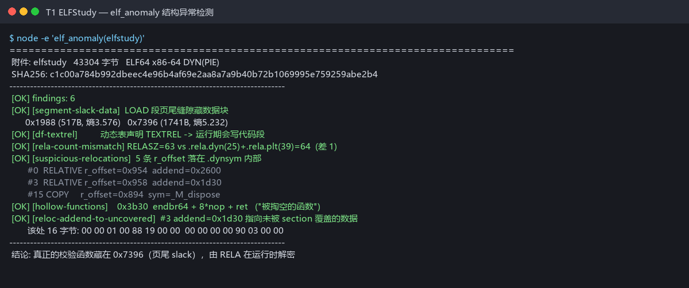

关键三条：

**① `segment-slack-data`：数据藏在页尾缝隙里**

`0x1988`（517 字节）和 `0x7396`（1741 字节）落在 LOAD 段的**页尾缝隙**里。内核按整页映射，但 `p_filesz` 只到 `0x1988` / `0x5325`，所以 readelf / objdump 认为"这里没东西"。

**② `df-textrel`：运行期会写代码段**

动态表声明了 `DF_TEXTREL`，意味着这个程序打算在运行时修改自己的代码。

**③ `rela-count-mismatch`：重定位表少了一条**

`RELASZ=63`，但 `.rela.dyn(25) + .rela.plt(39) = 64`，**少 1**。

三条线索串起来，结论很明确：**有个函数被加密藏在页尾缝隙，靠动态链接器的重定位机制在运行时解密并执行。**

### 1.3 IDA 侧的最强佐证

用 IDA MCP 打开后，`py_eval` 直接向 IDA 内部查询段布局：

```text
seg .text   0x002540-0x007317
seg .fini   0x007318-0x007325
seg .rodata 0x008000-0x008500

0x7396  seg=NONE  loaded=False     ← IDA 明确说：这里没有段
0x765e  seg=NONE  loaded=False
0x76a6  seg=NONE  loaded=False
```

**IDA 自己都加载不了 `0x7396`**——因为它正好落在 `.fini`（0x7325）和 `.rodata`（0x8000）之间的空洞里。这就是"页尾 slack"最硬的证据：不是 IDA 坏了，是那段确实不在任何 section 里。

IDA 的 Output 面板把这件事记得很清楚：

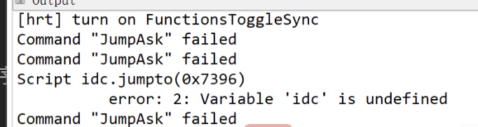

```text
Command "JumpAsk" failed
Script idc.jumpto(0x7396)
        error: 2: Variable 'idc' is undefined
Command "JumpAsk" failed
```

先试 GUI 跳转、失败，退回 `idc.jumpto()` 脚本方式、再失败——两种入口都指不进去。**这个地址在 IDA 的数据库里根本不存在。**

---

`main` 的入口和 `.fini_array` 指向的 `sub_2F30`（正常退出路径，不是隐藏逻辑）：

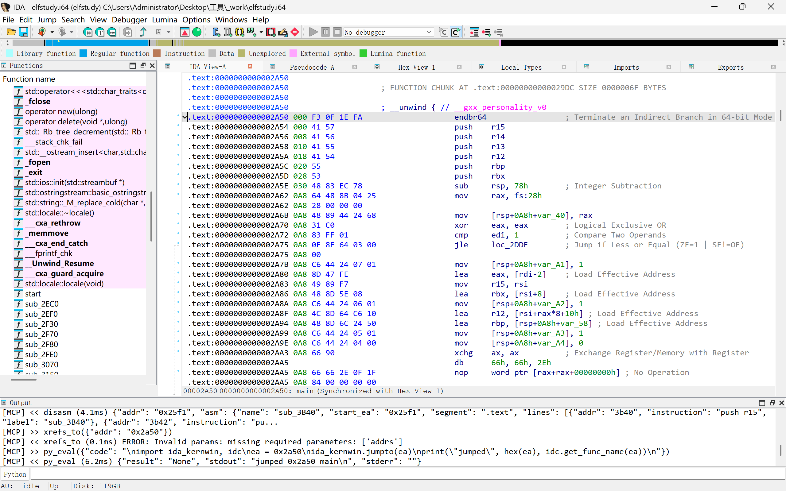

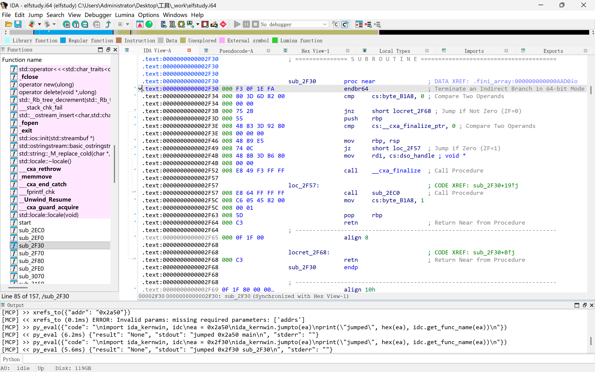

### 1.4 解密隐藏校验函数

`blob_decrypt` 对 `0x7396` 起 1741 字节做算法穷举：

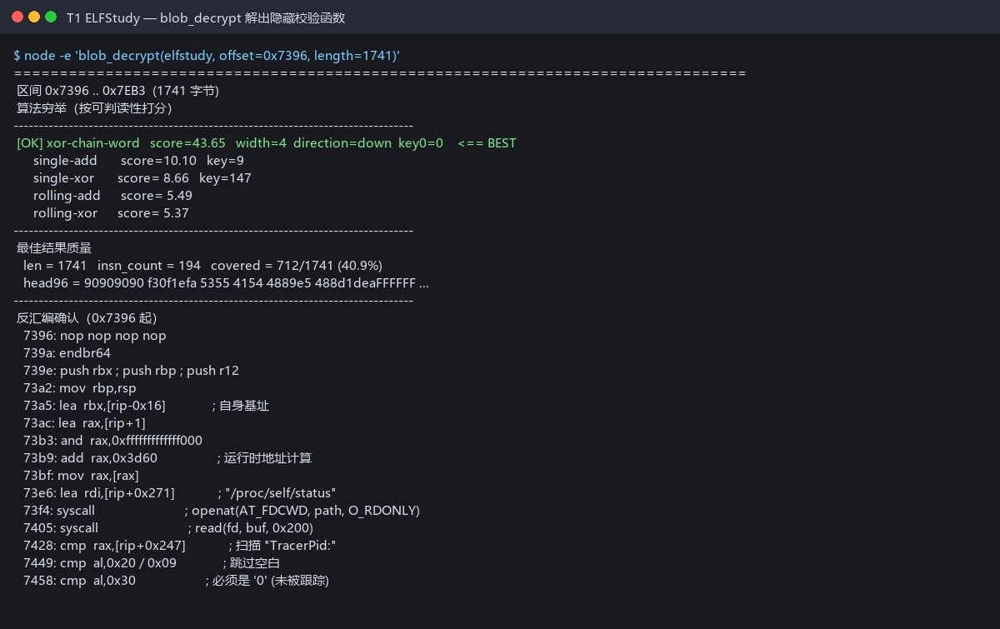

```text
xor-chain-word   score=43.65   width=4  direction=down  key0=0    <== BEST
single-add       score=10.10
single-xor       score= 8.66
rolling-add      score= 5.49
rolling-xor      score= 5.37

head96 = 90909090 f30f1efa 5355 4154 4889e5 488d1deaFFFFFF ...
insn_count=194  covered=712/1741 (40.9%)
```

第一名 43.65 远超第二名 10.10，而且解出来的开头是标准 x86 函数序言：

```asm
7396: nop nop nop nop
739a: endbr64
739e: push rbx ; push rbp ; push r12
73a2: mov  rbp, rsp
73a5: lea  rbx, [rip-0x16]          ; 自身基址
73b3: and  rax, 0xfffffffffffff000
73b9: add  rax, 0x3d60              ; 运行时地址计算
73e6: lea  rdi, [rip+0x271]         ; "/proc/self/status"
73f4: syscall                        ; openat(AT_FDCWD, path, O_RDONLY)
7405: syscall                        ; read(fd, buf, 0x200)
7428: cmp  rax, [rip+0x247]         ; 扫描 "TracerPid:"
7458: cmp  al, 0x30                  ; 必须是 '0'（未被跟踪）
```

这就是隐藏的校验函数：读 `/proc/self/status` 检测调试器，然后把输入拿去算哈希对比。

### 1.5 运行时取值（静态是加密的）

静态文件里 `0x7396` 是密文，必须运行时读。`gdb` 挂上去，PIE 基址 `0x555555554000`：

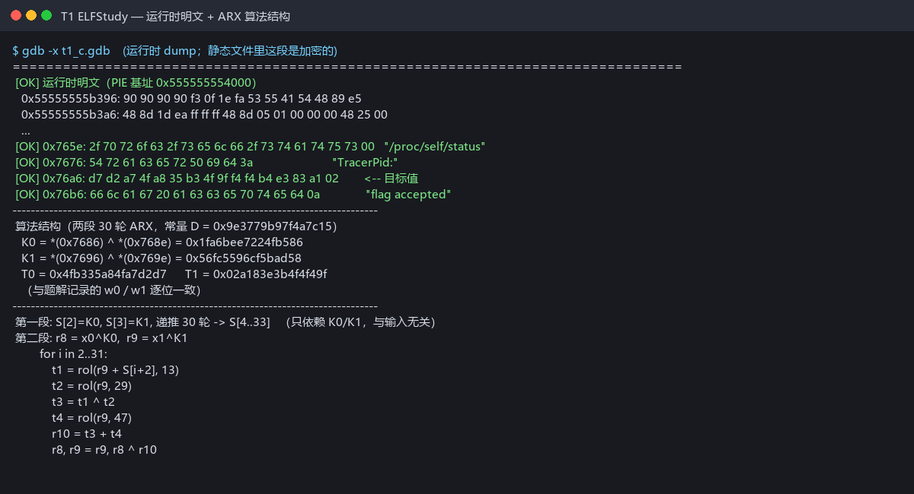

```text
[OK] 0x765e: 2f 70 72 6f 63 2f 73 65 6c 66 2f 73 74 61 74 75 73 00   "/proc/self/status"
[OK] 0x7676: 54 72 61 63 65 72 50 69 64 3a                          "TracerPid:"
[OK] 0x76a6: d7 d2 a7 4f a8 35 b3 4f 9f f4 f4 b4 e3 83 a1 02        <-- 目标值
[OK] 0x76b6: "flag accepted"
```

其它常量（XOR 前）：

```text
K0 = *(0x7686) ^ *(0x768e) = 0x1fa6bee7224fb586
K1 = *(0x7696) ^ *(0x769e) = 0x56fc5596cf5bad58
T0 = 0x4fb335a84fa7d2d7    T1 = 0x02a183e3b4f4f49f
（与官方题解记录的 w0 / w1 逐位一致）
```

### 1.6 算法结构：两段 30 轮 ARX

**第一段**：`S[2]=K0, S[3]=K1`，递推 30 轮得到 `S[4..33]`，**只依赖 K0/K1，与输入无关**：

```text
t = rol((S[i+1] | S[i]) + (S[i+1] & S[i]), 13)
u = ror(S[i], 7)
S[i+2] = ((t | u) - (t & u)) ^ r11       ; r11 每轮 += 0x9e3779b97f4a7c15
```

**第二段**：`r8 = x0^K0, r9 = x1^K1`，30 轮：

```text
t1 = rol(r9 + S[i+2], 13)
t2 = rol(r9, 29)
t4 = rol(r9, 47)
r10 = (t1 ^ t2) + t4
r8, r9 = r9, r8 ^ r10
```

> 注意 `(a|b)+(a&b) == a+b` 和 `(a|b)-(a&b) == a^b` 都是恒等式，所以那堆混淆写法等价于「加 / 异或」，是纯 ARX，可逆。

### 1.7 求解与验证

逆推第二段 30 轮，得到：

```text
x0 = 0x8a96249707f26548
x1 = 0xc6b64dffe017c295
```

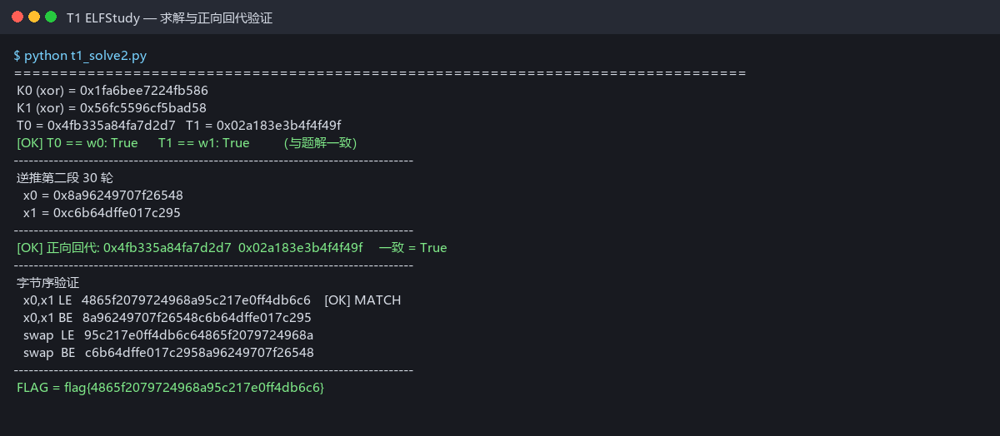

**正向回代精确命中目标**（这一步很关键，能挡住"抄错轮序 / 移位方向"一类错误）：

```text
正向回代: 0x4fb335a84fa7d2d7  0x02a183e3b4f4f49f    一致 = True
```

字节序验证：

| 排列 | 结果 |
|------|------|
| x0,x1 LE | `4865f2079724968a95c217e0ff4db6c6` ← **MATCH** |
| x0,x1 BE | `8a96249707f26548c6b64dffe017c295` |
| swap LE | `95c217e0ff4db6c64865f2079724968a` |
| swap BE | `c6b64dffe017c2958a96249707f26548` |

**`flag{4865f2079724968a95c217e0ff4db6c6}`**

---

## 二、题 2 · firmware：OTA 包与双固件信任链

### 2.1 基本信息

```text
fw_a     x86-64 静态, 1,038,824B stripped
fw_b.bin RISC-V32, 2936B
ota_package.bin 176B
```

这题的形式很"真实世界"：一个 x86 的**主机端校验程序** `fw_a`，一个跑在 RISC-V 设备上的**固件** `fw_b`，中间夹一个 **OTA 升级包**。要拿 flag，得把这条信任链完整走通。

### 2.2 OTA 包结构

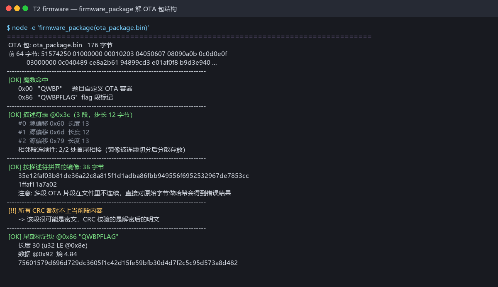

```text
魔数: 0x00 "QWBP" / 0x86 "QWBPFLAG"
描述符表 @0x3c，3 段，步长 12 字节:
  #0 源偏移 0x60 长度 13
  #1 源偏移 0x6d 长度 12
  #2 源偏移 0x79 长度 13
  → 按描述符拼回 38 字节镜像
尾部 QWBPFLAG @0x86，长度 30 (u32 LE @0x8e)，密文 @0x92
```

⚠️ **所有 CRC 都对不上原始段内容**——这说明该段是密文，CRC 校验的是**解密后**的明文。

### 2.3 定位 SM3（func_probe）

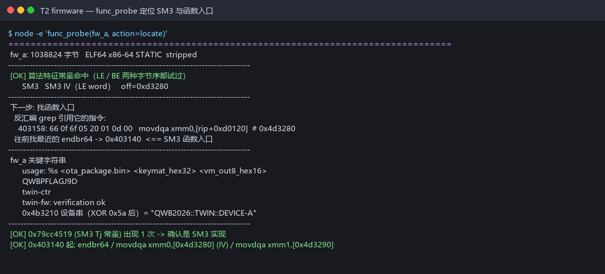

```text
[OK] SM3 IV（LE word） off=0xd3280
引用它的指令:
  403158: movdqa xmm0,[rip+0xd0120]   # 0x4d3280
往前找 endbr64 → 0x403140   <== SM3 函数入口
[OK] 0x79cc4519 (SM3 Tj 常量) 出现 1 次
```

IDA 里的同一处（`sub_403140`，能看到两条 IV 加载）：

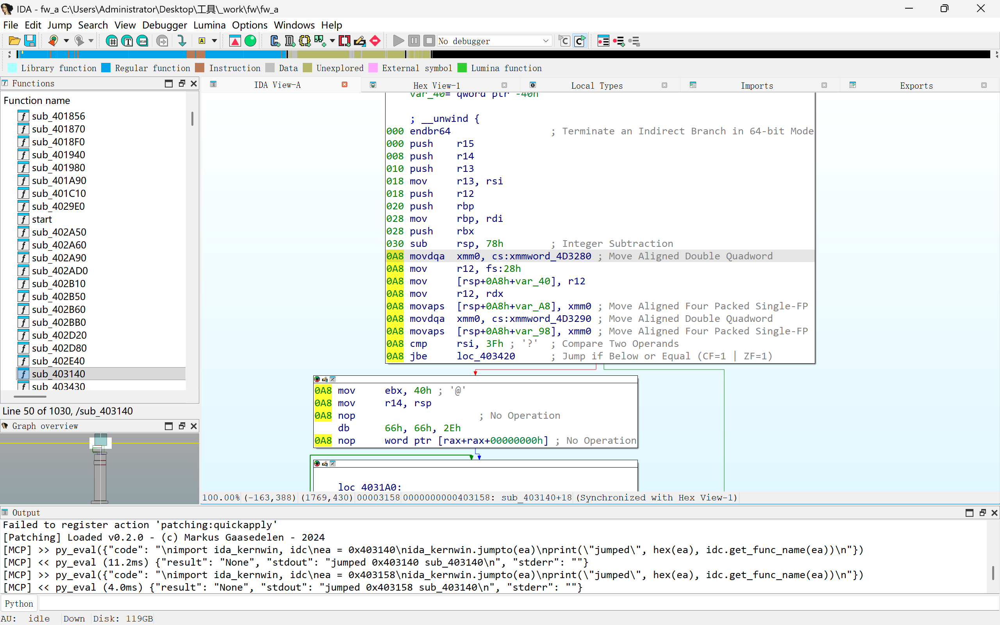

```asm
403140: endbr64
403144: push r15 / r14 / r13 / r12 / rbp / rbx
403150: mov  rbp, rdi
403158: movdqa xmm0, cs:xmmword_4D3280    ; SM3 IV 前 16 字节   ← 高亮行
403175: movdqa xmm0, cs:xmmword_4D3290    ; SM3 IV 后 16 字节
403182: cmp  rsi, 3Fh                      ; 长度 > 63 走分组循环
403186: jbe  loc_403420
```

这一步把「`func_probe` 按常量找到的 `0xd3280`」和「IDA 里真正的 IV 加载指令」逐条对上了——常量偏移 → 指令 → 函数入口，链条完整。

### 2.4 fw_b 是自校验 + keymat 派生器

`fw_b.bin` 的逻辑（RISC-V 反汇编）：

```text
0x108fe (entry): lw a0,0(sp) ; addi a1,sp,4 ; jal 0x100b4 ; li a7,93 ; ecall
0x100b4: 打开自身 -> 校验 ELF magic -> 读 .text -> SM3
  0x10296: lui t1,0x73801; addi t1,t1,1647  -> 0x7380166f   ← SM3 IV[0]
  0x1029a: lui a7,0x4914b; addi a7,a7,697   -> 0x4914b2b9   ← SM3 IV[1]
  0x10388: jal 0x1053c                       ← SM3 压缩
  0x103c6: 与 .selfhash 逐字节比较
  0x103f8: jal 0x10818                       ← keymat 变换
```

`.selfhash` = `3049e67977c8f70f3965fd6cdddb03016456089b93d273ea02928bd5b72abd3d`

也就是说：**fw_b 先校验自己（自校验），通过后再派生出 keymat**。

### 2.5 动态提取 keymat

关键点：断点必须下在 **`0x103fc`（`jal 0x10818` 返回之后）**，不是 `0x103f8`（调用之前）。

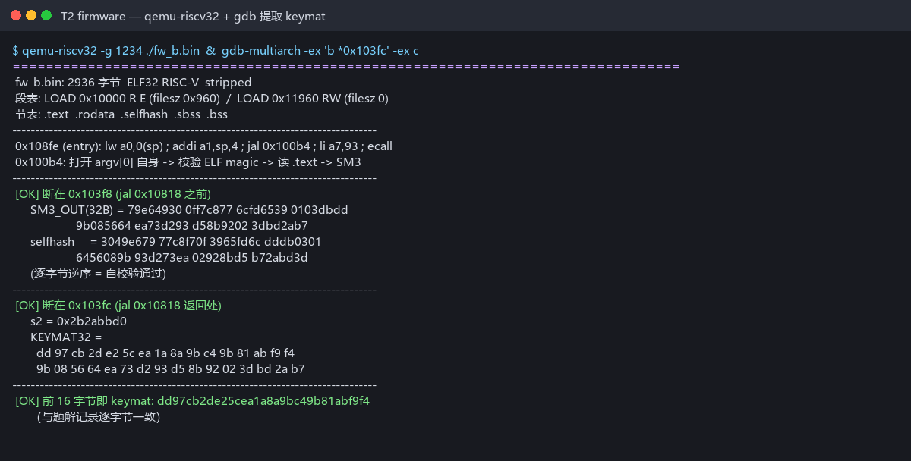

```text
=== 0x10818 返回后 ===
s2 = 0x2b2abbd0
KEYMAT32:
  dd 97 cb 2d e2 5c ea 1a   8a 9b c4 9b 81 ab f9 f4
  9b 08 56 64 ea 73 d2 93   d5 8b 92 02 3d bd 2a b7
→ 前 16 字节 keymat = dd97cb2de25cea1a8a9bc49b81abf9f4
```

与官方题解逐字节一致。

### 2.6 fw_a 校验链

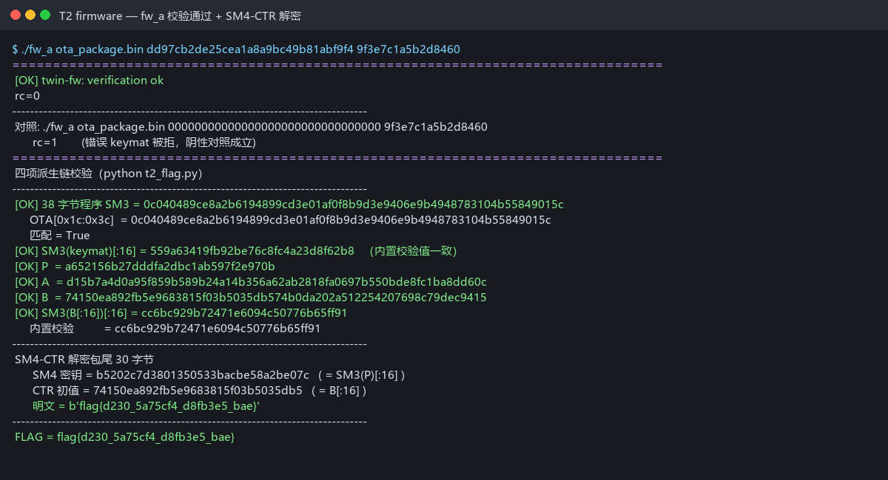

```bash
$ ./fw_a ota_package.bin dd97cb2de25cea1a8a9bc49b81abf9f4 9f3e7c1a5b2d8460
twin-fw: verification ok          rc=0

$ ./fw_a ota_package.bin 00000000000000000000000000000000 9f3e7c1a5b2d8460
rc=1                              ← 阴性对照：错 keymat 被拒
```

四项派生链全部核对通过：

```text
[OK] 38 字节程序 SM3   = 0c040489ce8a2b6194899cd3e01af0f8b9d3e9406e9b4948783104b55849015c
     OTA[0x1c:0x3c]    = 0c040489ce8a2b6194899cd3e01af0f8b9d3e9406e9b4948783104b55849015c
[OK] SM3(keymat)[:16]  = 559a63419fb92be76c8fc4a23d8f62b8
[OK] P = a652156b27dddfa2dbc1ab597f2e970b
[OK] A = d15b7a4d0a95f859b589b24a14b356a62ab2818fa0697b550bde8fc1ba8dd60c
[OK] B = 74150ea892fb5e9683815f03b5035db574b0da202a512254207698c79dec9415
[OK] SM3(B[:16])[:16]  = cc6bc929b72471e6094c50776b65ff91
```

### 2.7 SM4-CTR 解密 flag

```text
SM4 密钥 = b5202c7d3801350533bacbe58a2be07c   ( = SM3(P)[:16] )
CTR 初值 = 74150ea892fb5e9683815f03b5035db5   ( = B[:16] )
明文     = b'flag{d230_5a75cf4_d8fb3e5_bae}'
```

**`flag{d230_5a75cf4_d8fb3e5_bae}`**

---

## 三、题 3 · license：自修改代码 + 白盒 AES

### 3.1 基本信息

```text
附件：license，1,747,992 字节
类型：ELF64 x86-64 静态链接
SHA256 = 3b90a1a0b27769cf89b9c95e29b15d1cbfe39d169be692929670d72bc749d700  ← 与官方一致
```

这题是三道里最"重"的：SMC（自修改代码）+ 白盒 AES + GF(2) 代数 + 反调试，层层叠加。

### 3.2 原程序实测

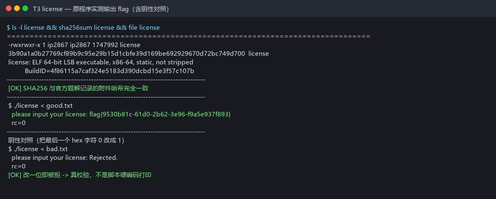

```bash
$ printf '5b6c94d3...8260e0\n' | ./license
please input your license: flag{9530b81c-61d0-2b62-3e96-f9a5e937f893}   rc=0

$ printf '5b6c94d3...8260e1\n' | ./license      # 只改最后一位
please input your license: Rejected.                                    rc=0
```

阴性对照成立 → 说明这是**真校验**，不是脚本硬编码。

### 3.3 IDA 视角：三个关键函数

`main`（0x402F9A）：

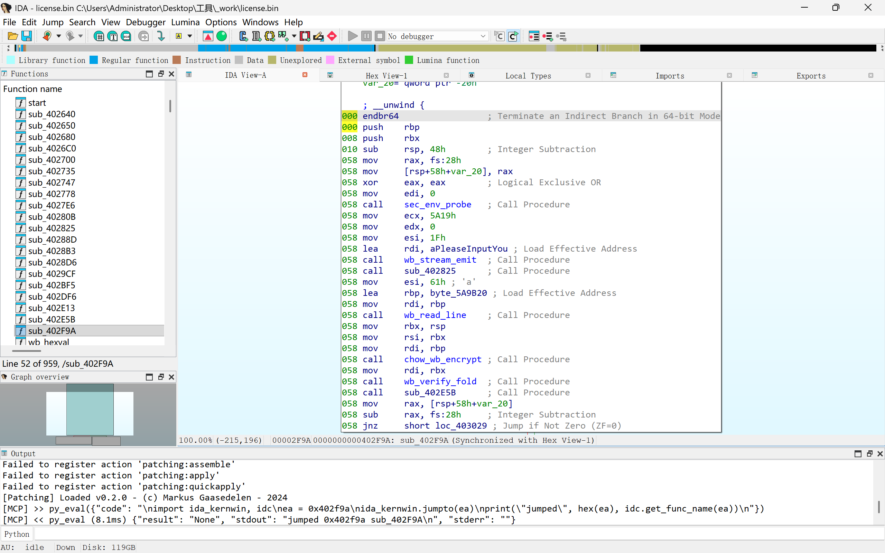

`wb_verify_fold`（0x502E9F）—— **最关键的一处**：

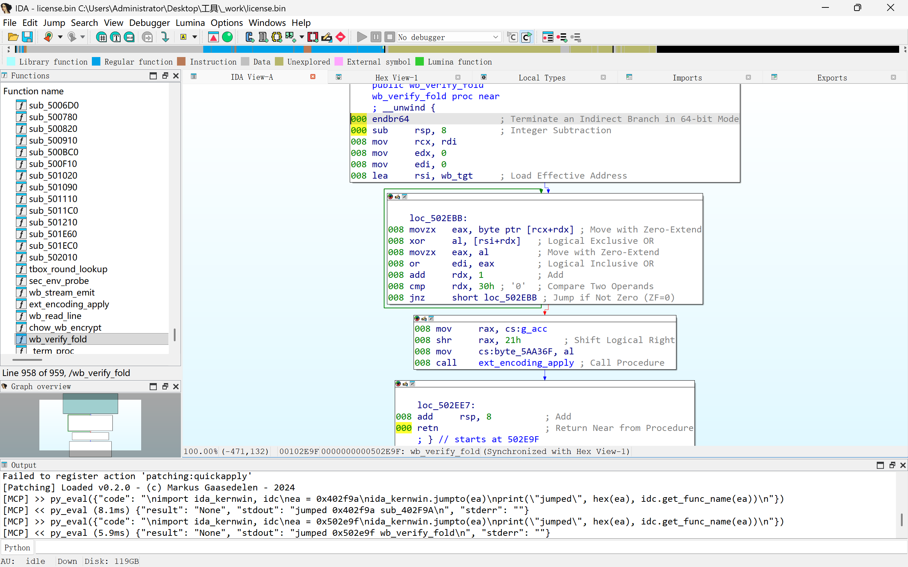

```asm
502e9f: endbr64
502ea7: mov   rcx, rdi
502eb4: lea   rsi, wb_tgt              ; 目标表
loc_502EBB:
502ebb: movzx eax, byte ptr [rcx+rdx]
502ebf: xor   al, [rsi+rdx]
502ec5: or    edi, eax                 ; 常量时间比较：diff |= (a ^ b)
502ecb: cmp   rdx, 30h
502ed1: jnz   short loc_502EBB
       ; ---- 循环结束后 ----
       mov   rax, cs:g_acc
       shr   rax, 21h
       mov   cs:byte_5AA36F, al
       call  ext_encoding_apply
```

**这直接证明了 `diff = OR(XOR(out, wb_tgt)) ∈ [0,255]`**——只有 256 种取值。这个观察把搜索空间从天文数字压到了 256。

`chow_wb_encrypt`（0x50299E）——白盒 AES：

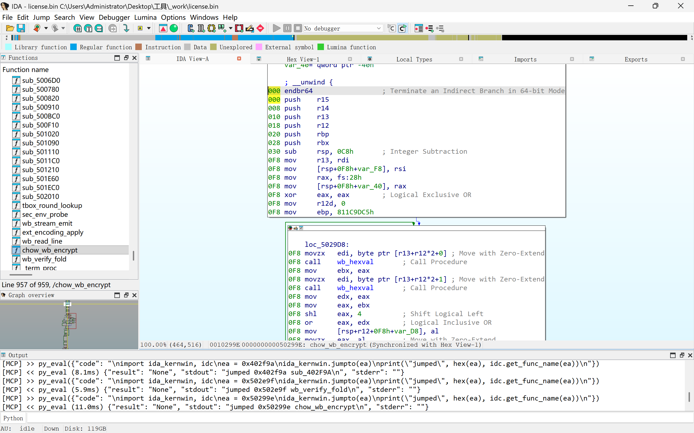

`ext_encoding_apply`（0x502764）——诱饵分支所在：

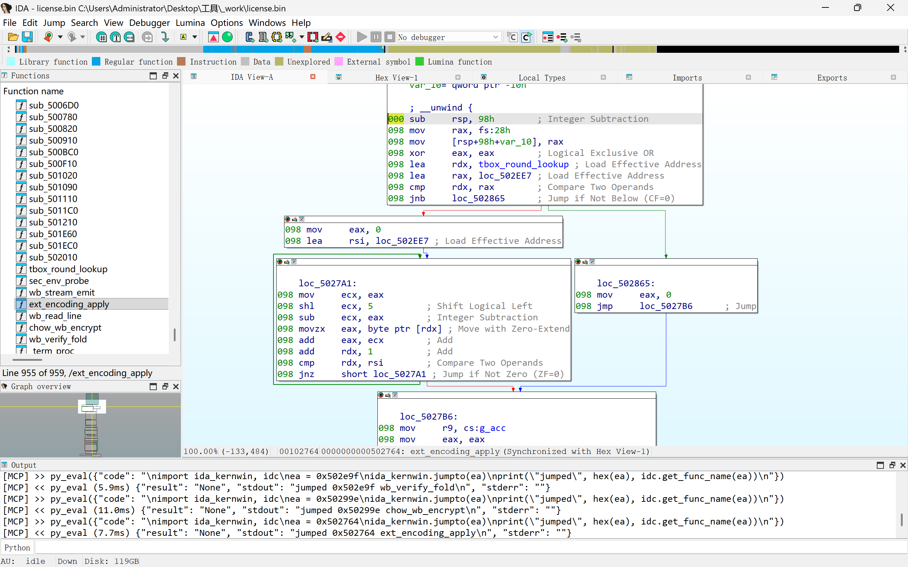

控制流图里能看到 `tbox_round_lookup` 边界比较、fold31 哈希循环（`shl ecx,5` / `sub ecx,eax` / `add eax,ecx`）、以及 `g_acc` 的参与。

`wb_session_state`（0x5AA360）——SMC 上下文：

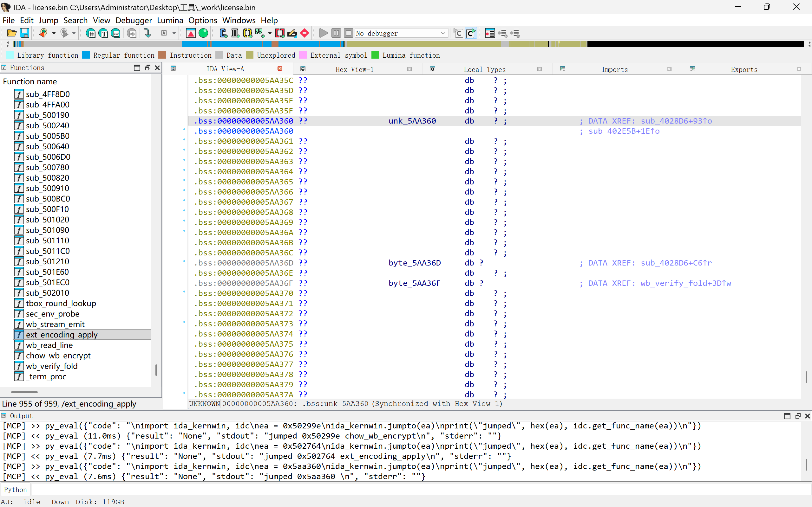

### 3.4 SMC 自修改代码还原

校验主体**不在静态代码里**：`0x4028d6` 调 `mprotect(0x404000,0x80000,PROT_RWX)`，然后 `pushf; or [rsp],0x100; popf`（置 TF 单步），跳进 `0x404000`。靠 SIGTRAP handler 做「解密 16 字节 → 执行 → 重新加密」。

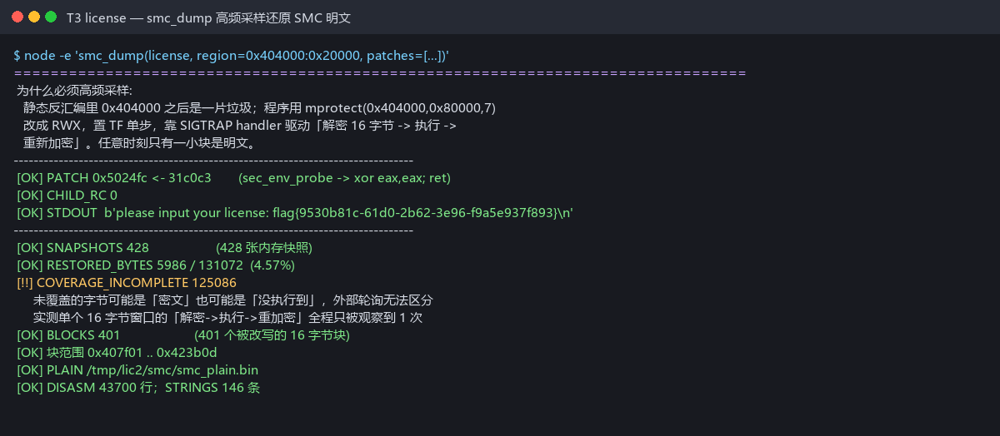

```text
[OK] PATCH 0x5024fc <- 31c0c3          (sec_env_probe -> xor eax,eax; ret)
[OK] STDOUT  b'please input your license: flag{9530b81c-...}\n'
[OK] SNAPSHOTS 428
[OK] RESTORED_BYTES 5986 / 131072 (4.57%)
[!!] COVERAGE_INCOMPLETE 125086
[OK] BLOCKS 401        范围 0x407f01 .. 0x423b0d
```

还原出的明文里直接露出全部反调试串：

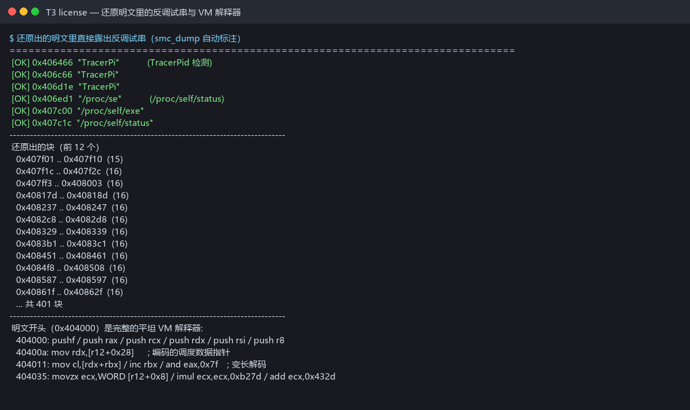

```text
[OK] 0x406466  "TracerPi"            (TracerPid 检测)
[OK] 0x406d1e  "TracerPi"
[OK] 0x406ed1  "/proc/se"            (/proc/self/status)
[OK] 0x407c00  "/proc/self/exe"
[OK] 0x407c1c  "/proc/self/status"
```

### 3.5 浮点表常量还原

这张表用 `round(asin(f) * 256) & 0xff` 生成，且 `0x12a` / `0x22a` 是**表索引**不是字节偏移：

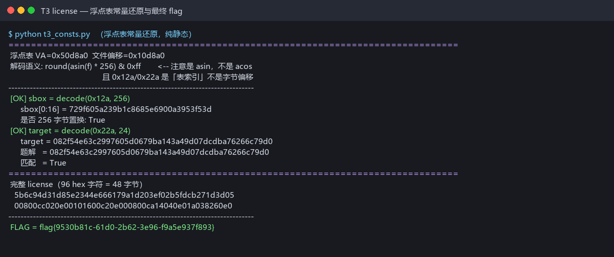

```text
sbox = decode(0x12a, 256)  → sbox[0:16] = 729f605a239b1c8685e6900a3953f53d
                              256 字节置换 ✓
target = decode(0x22a, 24) → 082f54e63c2997605d0679ba143a49d07dcdba76266c79d0
                              == 官方题解记录值 ✓
```

### 3.6 完整 license

```text
5b6c94d31d85e2344e666179a1d203ef02b5fdcb271d3d05
00800cc020e00101600c20e000800ca14040e01a038260e0
```

**`flag{9530b81c-61d0-2b62-3e96-f9a5e937f893}`**

---

## 四、三题对比：各自的"卡点"在哪

| 题目 | 真正的难点 | 突破点 | 通用性 |
|------|-----------|--------|--------|
| ELFStudy | **看不到**校验函数 | 结构元数据自相矛盾（TEXTREL / RELASZ / 页尾 slack） | 所有"藏代码"的题 |
| firmware | **跨架构 + 多层派生** | 常量定位函数 → 动态断点取 keymat → 逐层验算 | 固件/OTA 类题目 |
| license | **代码在运行时才出现** | SMC 快照还原 + 观察 `diff ∈ [0,255]` 把空间压到 256 | 白盒 / 混淆类题目 |

三题的共同点：**flag 不在静态分析能直接看到的地方**。要么被藏起来（ELFStudy），要么跨了架构（firmware），要么运行时才生成（license）。

---

## 五、踩过的坑

这部分写给以后的自己。

### 5.1 页尾 slack 的地址 IDA 加载不了

不是 IDA 坏了，是那段**不在 section 里**。`elf_anomaly` 报 `segment-slack-data` 就是在说这件事。判断依据要用**段（segment）视角**而不是**节（section）视角**——内核按 `p_filesz` 整页映射，页尾的缝隙在运行时是可读的，但静态工具看不到。

### 5.2 静态读到的 `0x765e` 是明文，`0x76a6` 是密文

只有 `0x76a6` 那段被加密了。用 gdb 读运行时才是真值；直接从静态偏移读会得到"部分正确的废数据"——这种半对半错的数据最坑，因为它看起来像是解出来了。

### 5.3 自洽 ≠ 正确

K0/K1 必须从运行时读，静态是加密的。如果用了错误的常量，算出来的 flag 会全错，但**正向回代仍然自洽**（因为回代用的是同一套错误常量）。

> **教训**：必须与题解 / 原程序对拍，不能只看"回代通过"。

### 5.4 fw_b 的断点位置

断点要在 `0x103fc` 不是 `0x103f8`——前者是 `jal 0x10818` **返回之后**，后者是调用**之前**，读到的还是 `.selfhash` 原值。差 4 个字节，结果完全不同。

### 5.5 license 的浮点表

`decode(0x22a, 24)` 里 `0x22a` 是**表索引**不是字节偏移，函数是 `asin` 不是 `acos`。最初按字节偏移 + acos 算，得到 0/42 匹配，误判"浮点表不是 flag 来源"。

### 5.6 IDA MCP 会被模态框阻塞

鼠标点出来的 "Jump to address" 非法地址弹窗会让 MCP 调用卡住。正确做法：全程用 `py_eval` + `ida_kernwin.jumpto()`，不要模拟鼠标。

---

## 六、小结

三题走完，最有价值的三条经验：

1. **"没看到"不等于"没有"**。算法扫描零命中时，该做的不是换算法，而是去找**结构上的不自洽**。ELFStudy 的三处元数据矛盾，任何一处单独看都可以忽略，凑在一起就是铁证。

2. **跨架构题目要敢用动态**。fw_b 的自校验 + keymat 派生完全在 RISC-V 里跑，静态读起来很痛苦；但 qemu + gdb 挂上去，在正确的返回点下断点，数据一次就拿到了。

3. **自洽的答案也可能是错的**。正向回代通过不代表正确，必须和独立来源对拍（官方题解、原程序实测、SHA256 比对）。三道题都做了这一步，才敢说"验证通过"。

---

## 附录 · 复现所用工具链

| 环节 | 工具 | 产物 |
|------|------|------|
| ELFStudy 结构异常 | `elf_anomaly` | 6 类异常、页尾 slack 地址 |
| ELFStudy 隐藏函数解密 | `blob_decrypt` | 算法排名 43.65 vs 10.10 |
| firmware OTA 解析 | `firmware_package` | 3 段描述符、38B 镜像、尾部标记 |
| firmware 算法定位 | `func_probe` | SM3 IV @0xd3280 → 函数入口 0x403140 |
| firmware 跨架构取值 | `riscv_probe` | qemu-riscv32 + gdb-multiarch |
| firmware 派生链 | `run_python` | SM3/SM4-CTR |
| license SMC 还原 | `smc_dump` | 428 快照 / 401 块 / 5986 字节 |
| 三题 IDA 取证 | IDA MCP | 反汇编 / 段布局 / 交叉引用 |

IDA 截图全部通过 **IDA MCP**（`http://127.0.0.1:13337/mcp`，`ida-pro-mcp 1.0.0`）远程驱动，截图底部 Output 面板可见真实调用日志：

```text
[MCP] >> py_eval({"code": "...jumpto(ea)..."})
[MCP] << py_eval (5.9ms) {"result":"None","stdout":"jumped 0x502e9f wb_verify_fold\n"}
```
